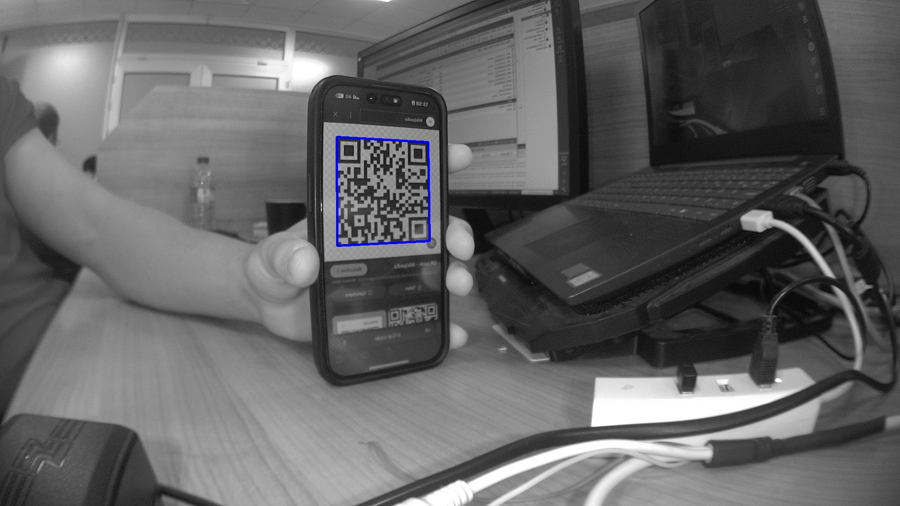
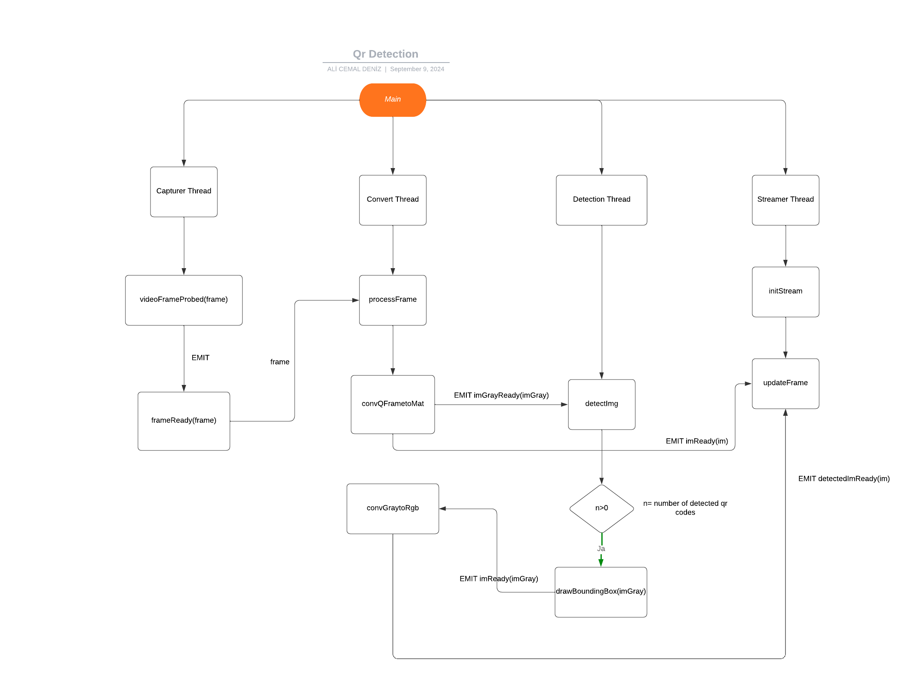

# Qt QR Code Detection on Rockchip RK1808

Qt/C++ experiments, August–September 2024, on detecting QR codes in a live camera feed on an embedded **Rockchip RK1808** camera board and streaming the annotated video over **RTSP**. The repo also contains the small Qt tutorial projects (threads, timers, multimedia) used to get there.



## Final pipeline: `qr_detection_rtspserver`

Each stage runs in its own `QThread` and passes frames along with Qt signals, so capture, detection and encoding don't block each other:



1. **Capturer:** `QCamera` + `QVideoProbe` grab frames from the board camera.
2. **Converter:** `QVideoFrame` → grayscale `cv::Mat`.
3. **Detector:** ZBar finds QR codes, and a bounding box is drawn for each one.
4. **Streamer:** GStreamer RTSP server, `appsrc ! mpph264enc ! rtph264pay`. It uses the RK1808's hardware H.264 encoder (Rockchip MPP).

## Projects

**QR detection (RK1808)**

| Folder | What it does |
|---|---|
| `qrdetection_image` | ZBar on still images; results in `resources/results/` |
| `qrdetection_videcapture` | Live detection from `QCamera` / OpenCV `VideoCapture` |
| `qrdetection_qvideoprobe` | Frames via `QVideoProbe`, ZBar detection and an RTSP stream, all without worker threads |
| `qt_qrdetection_rtsp` | Earlier variant of the same flow |
| `qr_detection_rtspserver` | **Final version:** four-thread pipeline above |
| `qr_detection_yolov3` | Alternative detector: YOLOv3-tiny through OpenCV DNN. Model files aren't included, and the paths in `mainwindow.cpp` are placeholders. |
| `streamer` | Standalone GStreamer RTSP streamer with the MPP encoder |
| `qt_rtsp` | RTSP client (`QMediaPlayer`) for viewing the board's stream |

**Qt tutorials:** `qt_tutorial_threads`, `qt_tutorial_threads2`, `qt_tutorial_threadsdoneright` (worker objects with `moveToThread`), `qt_tutorial_timer`, `qt_tutorial_file`, `qt_tutorial_displaying_windows`, `qt_tutorial_videoplayer`.

## Building

Each folder is a qmake project (`*.pro`). Open it in Qt Creator, or build from the command line:

```bash
cd qr_detection_rtspserver
qmake && make
```

Desktop builds use Qt 6. The board builds use the RK1808 cross-compilation kit, with OpenCV, ZBar and GStreamer (plus `gst-rtsp-server`) from the board sysroot, as the `LIBS` entries in the `.pro` files show. Connect to the stream at `rtsp://<board-ip>:8554/test`.
